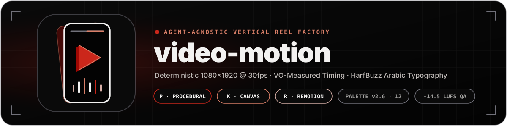

<p align="center">
  
</p>

# video-motion — استوديو ريلز ميدو 🎬

مستودع واحد فيه كل حاجة لصناعة **ريلز عمودي 1080×1920** من أوله لآخره:
هوية مقفولة (بالِت ١٢ لون)، وخطوط وحركة نص بيختارهم الوكيل لكل مشهد، وثلاثة محركات رندر، وطبقة أيقونات متحركة، وأدوات صوت، وقواعد عربي سليم،
وكل ده شغال مع **أي وكيل برمجي** — مش كلود بس.

**حقوق الاستخدام:** مفيش حاليًا ترخيص Open Source شامل للكود والمواد الأصلية؛ أي إعادة استخدام محتاجة إذن منفصل من صاحب المشروع. تراخيص الخطوط والأيقونات تخص مكوناتها بس. [تفاصيل الترخيص](medo-motion/LICENSE.md) · [نسب الأصول](assets/CREDITS.md).

**المرجع الموحّد لنظام التصميم:** [`DESIGN_SYSTEM.md`](DESIGN_SYSTEM.md).

---

## إزاي بتشتغل

إنت بتدّي **٤ حاجات** بس:

| # | الحاجة |
|---|---|
| ١ | **السكريبت** (يفضل beats مرقمة + اللي يظهر على الشاشة) |
| ٢ | **توجيه المشاهد** (إزاي عايز المشاهد تتقدم) |
| ٣ | **صوت التعليق** (تسجيلك) |
| ٤ | **صور ميدو** — **٤٩ وضعية جاهزة جوه المكتبة**؛ بتتطلب صورة زيادة بس لو مشهد محتاج وضعية مش موجودة |

والباقي كله على الوكيل: الخلفيات والكروت والأجهزة والكابشن والحركة والمؤثرات والموسيقى
والتوقيت وأي أصل خارجي (كود ← توليد AI ← بحث) مع تسجيل التراخيص.

**مفيش لوجو قناة تلقائي جوه الفيديوهات، ومفيش اسم سلسلة افتراضي، ومفيش رقم حلقة.** ده استوديو إنتاج: إنت بتقول عايز إيه.
لو عايز اسم أو عنوان أو رقم حلقة أو شعار شرح معيّن على الشاشة، إنت اللي بتقرره — الوكيل بينفّذه ومش بيقترحه (وبنر الريبو فوق `docs/assets/` تجميلي لواجهة GitHub بس ومش بيتحط على أي فيديو).

**الاستوديو أداة، مش أرشيف فيديوهات:** مجلدات `projects/` مساحة شغل مؤقتة ومستثناة بالكامل من Git،
والفيديو اللي بيخلص بيخرج مع مجلده — فيديوهاتك القديمة مش بتتخزن في المستودع ومش بتُستخدم كمرجع لفيديو جديد.

**الخطوط مجانية كلها:** ٢١ عيلة (١٢ عربي + ٩ إنجليزي) SIL OFL 1.1 — الوكيل بيختار الأنسب والأجذب
لكل مشهد/عنصر ويسجّل اختياره في `plan/text-direction.json`؛ مفيش خط افتراضي مفروض. Cairo/Inter
مجرد شبكة أمان لكروم النظام. الأدوار والأزواج وشيت المعاينة في `docs/fonts.md`.

**الحركة على إيقاع:** شبكة BPM واحدة بتحكم القطع والـhits والميكرو-حركة (`beat.py`/`lib/beat.js`)، والعناصر
بتتحوّل في مساحة 3D (`space3d.py`/`lib/space3d.js`) بدل ما تتقطع، وأي حركة سريعة بتاخد velocity blur
من سرعتها الحقيقية (`docs/rhythm.md`).

**وطول الفيديو = طول تسجيلك بالظبط** — مفيش طول مستهدف ولا تطويل ولا قص لتوصيل رقم:
`tools/vo_length.py` بيقيس الصوت ويطلّع منه حدود المشاهد، والمحركات التلاتة بتمشي عليه (`docs/length.md`).

**الحرفة بقت مقاسة ومحكومة**: `tools/techniques.py` بيسحب حركات الريل من مكتبة **٢٢٣٩ تقنية** في ٤٤ فئة:
- **٥٩ تقنية أصلية** من الاستيديو (philosophy-driven)
- **١٣٧٥ تقنية** من Alansari Motion Library (٢٧٥ حركة + ١١٠٠ متغير)
- **٦١٦ تقنية** من Opus Motion Library
- **١٨٩ انتقال GLSL** من gl-transitions

و`tools/reel_lint.py` بيفحص الخطة قبل الرندر
(كلمات الشاشة، مدة القراءة، القطع على الشبكة، المساحات الفاضية، واللوكات الممنوعة) — الشرح والأرقام
كلها في `docs/craft.md`، والمكتبة المقروءة في `docs/techniques.md`.

**١٢٥ خط مجاني** (٦١ عربي + ٦٤ إنجليزي) SIL OFL 1.1 — مجموعة ضخمة من الخطوط العربية والإنجليزية تشمل Aref Ruqaa, Reem Kufi, Qahiri, Fustat, Lalezar وغيرها. الوكيل بيختار الأنسب لكل مشهد.

**١٦٣ ستايل بصري** (`assets/styles/styles.json`) — لغة بصرية كاملة لكل فيديو: باليت ألوان، خطوط، سطح، شخصية:
- **١٧ ستايل** من Majed Video (keynote, paperCut, explainer, terminal, vhs, brutal...)
- **١٤٦ ستايل** من Opus Motion Library (woodcut, risograph, neon-noir, crt-terminal...)
[التفاصيل](docs/STYLES.md).

**١٨٩ انتقال GLSL** (`assets/gl-transitions/`) — شيدورات GPU جاهزة: Accordion, Bloom, CircleIris, Cube, DoomScreen, Flash, Glitch, Morph, PageTurn, Ripple, Spiral, Wave, Zoom... [التفاصيل](docs/GL_TRANSITIONS.md).

**مبادئ تصميم الحركة** (`docs/motion-principles/`) — مستوحاة من LottieFiles: 12 مبدأ ديزني مكيفة للواجهات، 4 شخصيات حركة، جداول توقيت، خرائط عاطفة→حركة. [التفاصيل](docs/MOTION_PRINCIPLES.md).

**توليد موسيقى خلفية** (`tools/audio_generate.py`) — موسيقى وخلفية صوتية مركّبة رياضياً (numpy/scipy) بدون عينات خارجية = بلا حقوق. درامز + باس + Lead + chord progression + ducking تلقائي + -14 LUFS mastering.

**الصورة ليها سبب وفحص:** `visual_direction.py` بيربط كل beat بكلمة مقاسة ومعالجة متكلم/overlay/cover؛
وصفات مقارنة/خط زمني/عدّاد أصلية لـK وR، و`layout_audit.mjs` بيفحص نصوص K/مناطق الوجه المسجلة
ويطلع إطار المخالفة وصور معلّمة. [الشرح والأوامر والحدود](docs/visual-data-qa.md).
**استمرارية بدل الاستبدال:** الكارت نفسه يتحول لمساحة شرح في K/R، و`--replay` يعيد إطارات K بالعكس
ويكشف تغيّر البكسلات/التخطيط عند نفس الزمن. [الانتقاء من Charlie والتطبيق الأصلي](docs/charlie-motion-review.md).


**عندك فيديو مرجعي؟** الاستوديو يطلع منه contact sheets، شريط للحركة، وتقديرات للقطع/الألوان/الإيقاع، وبعدها يحفظ الترجمة المتوافقة مع هوية ميدو في `STYLE.md` — من غير نسخ المحتوى أو الشعار. `docs/reference-workflow.md`.

---

**توسعات Motion بدون واجهة تأليف جديدة:** المرحلة الأولى تضيف markers/sequences وstagger متقدم
ودورات محدودة ومسارات منحنية؛ والمرحلة الثانية تضيف springs/inertia وretarget/follow وvariants وربط قيم
بحسابات مشتركة لـP/K/R، من غير live inputs. المرحلة الثالثة تضيف تخطيط مجموعات وقياس نص حقيقي
ورسم مسارات محددة وربط خصائص آمن؛ [حدودها واستخدامها](docs/motion-geometry.md). باقي الاختيارات محفوظة بحالتها، مش مُعلنة جاهزة.
المرحلة الرابعة تضيف خيارات رندر محدودة و[دعم SVG ثابت بعقد واضح](docs/motion-svg.md)، مع رفض ما لا يدعمه.
المرحلة الخامسة تضيف [تسلسلات متداخلة ومورفًا محدودًا للحلقات المتوافقة](docs/motion-nested-morph.md).
المرحلة السادسة تربط [الحركة الزخرفية المخفّفة والموارد والقياس](docs/motion-render.md) اختياريًا بالرندر مع إبقاء الوضع العادي افتراضيًا.
المرحلة السابعة تقدّم [فحصًا محليًا ودراسة جدوى لـThree وvgpu](docs/motion-gpu-feasibility.md) دون تثبيت إضافات أو ادعاء دعم GPU.
المرحلتان الثامنة والتاسعة تضيفان [طبقة Three اختيارية محدودة لـK وR](docs/motion-three.md)، ومختبرة برمجيًا في Hybrid، دون افتراض GPU.
المرحلة العاشرة تضيف [نوافذ رسم خطوط SVG مستقلة](docs/motion-svg.md) في P/K/R ضمن subset محدود وحتمي.
[الخطة والاستخدام وحدود المنفَّذ](docs/motion-rollout.md).

## أول تشغيل

ثبّت Python 3.12 وNode 20.11+ مع npm الأول (السكربت مش بيثبتهم).
ابدأ من جذر المستودع الكامل؛ [دليل البيئة النظيفة والتطوير](docs/development.md):

```bash
python3 -m venv .venv
source .venv/bin/activate
bash tools/setup.sh --dev  # حزم التشغيل والاختبارات · ffmpeg/shim · خطوط · Chromium
python3 tools/doctor.py    # تقرير READY / DEGRADED / BLOCKED لكل قدرة
python3 tools/selftest.py           # doctor + اختبارات + رندر P/K + فحص قالب R
python3 tools/selftest.py --remotion # كمان npm ci + typecheck + رندر فعلي من R
python3 tools/selftest.py --hybrid   # رندر فعلي لمقاطع P + K + R وتجميعها مع مسار صوت
```

أو باختصار: `make setup` · `make doctor` · `make selftest` · `make test` · `make new SLUG=my-reel` · `make studio` · `make transitions` · `make sfx` · `make poses` · `make fonts` · `make length VO=…` · `make techniques PLAN=…` · `make lint P=…` · `make layout-p P=…` · `make qa MP4=…` · `make gate P=…`

مشروع جديد:

```bash
python3 tools/new_project.py my-reel --engine p   # محرك الشخصية/الشرح (الأنسب للريلز اللي فيها كلام)
python3 tools/new_project.py my-reel --engine k   # محرك كانفس/تايبوغرافي
python3 tools/new_project.py my-reel --engine r   # محرك Remotion (React/TypeScript)
python3 tools/new_project.py my-reel --engine hybrid # P/K/R في مقاطع متتابعة
```

أوامر npm للمشروع (`npm ci` / `npm run studio`) خاصة بمحرك **R** و**Hybrid** فقط — قوالب P وK لا تحتاج أي سكربت npm:

```bash
# R أو Hybrid فقط:
cd projects/my-reel && npm ci && npm run studio
# محركات P وK: شغّل السكربتات مباشرة من جذر المشروع (شوف AGENTS.md §5)
```

ملفات `BRIEF.md` و`plan/` وكود المشروع قابلة للتتبع بـGit؛ الفيديوهات والكاش ومجلدات `out/` متجاهلة.
بعدها املأ `projects/<المشروع>/BRIEF.md` بالأربعة، وقول للوكيل: **«اقرأ AGENTS.md وابدأ»**.

---

## اللي جوه

```
AGENTS.md              ← عقد التشغيل لأي وكيل (اقرأه الأول)
assets/                ← مدخلات مشتركة:
  fonts/               ← ١٢٥ عيلة OFL (٦١ عربي + ٦٤ إنجليزي)
  styles/              ← ١٧ ستايل بصري (styles.json)
  techniques.json      ← ١٤٣٤ تقنية حركة
  poses/ · sfx/
projects/<slug>/       ← مساحة شغل مؤقتة للفيديو (مستثناة من Git): BRIEF.md · STYLE.md · plan/ · assets/ · out/
tools/                 ← setup.sh · doctor.py · selftest.py · new_project.py · render_hybrid.py · vo_length.py · analyze_ref.py · techniques.py · reel_lint.py · machine_explainer.py · layout_audit.mjs · layout_audit_p.py · media_qa.py · stage_gate.py · phone_preview.py · asr_check.py · ffprobe_shim.py · chromium.mjs
                       · audio_generate.py (توليد موسيقى numpy/scipy بلا حقوق)
                       · icons_sheet.py · icons_preview.mjs
                       · merge_alansari.py · add_variants.py · extract_styles.py
tests/                 ← اختبارات pytest (تشكيل عربي، البراند، السكافولد، فريم حقيقي)
docs/                  ← التحليل + قواعد الاتساق + STYLES.md · COMPARISON_MAJED.md · ALANSARI_INTEGRATION.md
medo-motion/           ← حزمة أدوات Video Motion: الهوية، المراجع، الأيقونات، وقوالب المحركات
  SKILL.md             ← نقطة دخول كلود كود (بتحوّل لـ AGENTS.md)
  brand/               ← الهوية: BRAND.md للبني آدم + brand.json للكود
  reference/           ← أدلة تُقرأ عند الحاجة (العربي إلزامي قبل أي نص على الشاشة)
  icons/              ← ٢٧٥ أيقونة متحركة (١٢ بيت + ٢٦٣ من itshover): registry → SVG + محرك K + محرك P
  motion/             ← لغة الحركة: easings.json (منحنيات motion.dev + معادلات Penner) + تايملاين + transitions.json
  styles/               ← ستايلات إلهام قابلة لإعادة الاستخدام (مش defaults مفروضة)
  templates/           ← محرك P (Pillow/OpenCV/FFmpeg) + K (Canvas/Playwright) + R (Remotion/React)
  scripts/             ← preflight · brand_check · get_fonts · SFX · TTS · preview
```

---

## المحركات

| | إمتى تستخدمه | بيشتغل إزاي |
|---|---|---|
| **P** | ريلز فيها ميدو + كروت + أجهزة + كابشن | Pillow + OpenCV، رندر بالـchunks (قابل للاستئناف) |
| **K** | تايبوغرافي حركي، قوائم، واجهات، معاينات سريعة | Canvas في Chromium (Playwright) |
| **R** | مشاهد React قابلة لإعادة الاستخدام، رسوم بيانات وواجهات مركّبة، ومعاينة Remotion Studio | Remotion + React/TypeScript داخل Chromium |

اختار محرك واحد للفيديو، أو `hybrid` لما أجزاء مختلفة تحتاج P/K/R: كل مقطع كامل الإطار يترندر بمحرك واحد، بالتتابع، ومش طبقات متزامنة. التفاصيل في `docs/hybrid.md`.
نفس البالِت من `brand/brand.json`. R مش أسرع تلقائيًا من K؛ اختاره لما إعادة استخدام مكونات React أو Studio تفرق فعلًا.
الأيقونات المتحركة مدمجة حاليًا في K وP: `medo-motion/icons/` → `lib/icons.js` (K) + `icons.py` (P) + `svg/` (ويب).
مكتبة **itshover** (٢٦٣ أيقونة، Apache-2.0) مولّدة للمحركين دول — الشرح في `docs/icons.md`.

والحركة ليها لغة واحدة (`medo-motion/motion/`) بنفس منحنيات **motion.dev** وتايملاين keyframes زي **Theatre.js**:
نفس الـJSON بيتنفّذ في المحركات التلاتة بنفس ملف حساب الحركة، وفي استوديو أوفلاين بتراجع بيه الحركة قبل الرندر — `docs/motion.md`.

**ميدو بقى جوه المشروع:** **٤٩ وضعية** لنفس الشخصية (٣٠ كامل + ١٩ نصف جسم) — وقوف أساسي، تحية
واحتفال، تفكير وسؤال، مشاعر وimpact، حركة، قعدة، وأجهزة وأوراق (لابتوب، موبايل، ورقة، كوباية، ساعة)،
زائد مجموعة نصف جسم بتقرأ كـpush-in: إشارات، صمت، إنصات، حيرة، وابتسامة. كلها PNG شفاف أصلًا، بنفس
الطول ونفس خط الأرض (والنصف جسم على دليل أعلى 190)، بحركة تنفّس وميلان — P وK عندهم أنظمة الوضعيات
الكاملة، وR فيه `MedoPresenter` لمواضع وصور الوضعيات. الوضعية بتتطلب منك **بس** لو المشهد محتاج حاجة
المكتبة مفيهاش. `docs/presenter.md`.

**القطع والمؤثرات كمان بقوا كتالوج:** ١٤ انتقال (`wipe`, `iris`, `checker`, `slide`, `glitch`…) هندستهم
واحدة في المحركين وكل واحد مربوط بصوته من مكتبة **١٥ مؤثر برمجي** (`whoosh`, `pop`, `impact`, `chime`…) —
الـhits بتتولّد بالكود فالترخيص مفتوح والتزامن مظبوط للفريم. `docs/transitions.md` · `docs/audio.md`.

---

## حالة البيئة (اللي اتظبط)

| القدرة | الحالة |
|---|---|
| Python: Pillow · numpy · scipy · OpenCV · PyAV · HarfBuzz · FreeType | ✅ |
| FFmpeg 7.0.2 (x264/aac) + بديل `ffprobe` متوافق | ✅ |
| Arabic shaping: بديل HarfBuzz+FreeType (`arabic_shape.py`) لأن Pillow هنا من غير libraqm | ✅ |
| Chromium (من `@sparticuz/chromium`) لمحرك K | ✅ |
| Remotion 4 (محرك R) | ✅ القالب متكامل؛ كل مشروع Remotion يثبّت تبعياته عبر `npm ci` |
| ٢١ عيلة خطوط OFL في `assets/fonts/` | ✅ |
| المحركان P وK | ✅ اتجربوا ورندروا فريمات عربية صح |
| محرك R | ✅ رندر تجريبي بـRemotion/Chromium؛ `npm run render` يراجع WAV والتوقيت |
| الاختبارات (`make test` · `make selftest`) | ✅ CI + اختبارات P/K/R؛ `python3 tools/selftest.py --hybrid` يرندر ويجمع محركات P/K/R مع صوت فعليًا |
| مفتاح ElevenLabs | ❌ اختياري — الصوت بييجي منك |

شغّل `python3 tools/doctor.py` في أي وقت للتأكد.

---

## الملكية والتراخيص

**Video Motion مشروع مستقل خاص بميدو.** الإشارات القديمة إلى أسماء أو جهات أخرى، أو وصف المشروع بأنه fork أو نسخة من منتج خارجي، كانت أخطاء توثيق نتجت عن تراكم تعديلات الـVibe Coding؛ وقد أُزيلت من التوثيق ولا تمثل مصدر المشروع أو سجل ملكيته.

هذا لا يلغي تراخيص المكونات الخارجية المضمّنة أو المستخدمة. تظل كل مكتبة أو خط أو أصل خارجي خاضعًا لترخيصه الأصلي، مع تسجيل النسب في `assets/CREDITS.md` والاحتفاظ بملفات الترخيص بجوار المكوّنات، ومنها itshover (Apache-2.0) والخطوط (SIL OFL 1.1).

لا يعيّن هذا المستودع حاليًا ترخيص Open Source شاملًا للكود والمواد الأصلية الخاصة بالمشروع. لا تخلط بين ملكية المشروع وبين حقوق إعادة توزيع مكونات الطرف الثالث.

الجولة الأخيرة المجانية توسّع SVG والتسلسل والتخطيط والموارد وتختبر بدائل 3D وWAAPI محليًا؛ التفاصيل وحدود ما بقي في [سجل التنفيذ](docs/motion-rollout.md). Motion+ والمشتريات مستبعدة.
