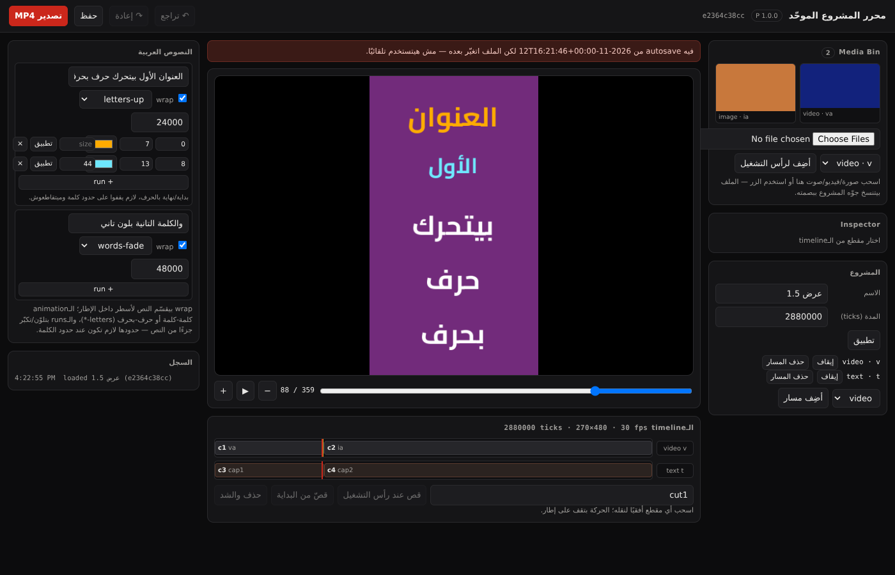

# المحرر المحلي: أول واجهة مرئية فوق النواة

**الحالة:** منفّذ (2026-11-12) · **الكود:** `tools/editor_server.py` + `editor/index.html`
**الاختبارات:** `tests/test_editor_server.py` (13) · `tests/test_editor_ops.py` (7)
**اتجرب في متصفح:** Chromium 138 headless (2026-11-12) — النتيجة تحت في §5

البند الرابع في [`development-plan-status.md`](development-plan-status.md) §3 كان «المحرر المرئي». النواة
(split/trim/move/ripple/snap/undo/حفظ ذري) كانت جاهزة ومجرّبة من الـCLI، والناقص كان الواجهة. الصفحة دي
هي الطبقة الأولى: **بيانات حقيقية، عمليات حقيقية، نفس الدوال** — مش نموذج بالورق.

## 1. التشغيل

```bash
python3 tools/editor_server.py projects/demo/project.json --port 8777
# ثم افتح http://127.0.0.1:8777
```

- بيربط على `127.0.0.1` افتراضيًا لأنه **بلا مصادقة**. `--host 0.0.0.0` للـpreview proxy فقط، ومع
  شبكة موثوقة.
- الصفحة ملف واحد بلا npm ولا CDN: HTML + JS عادي، فتعمل offline وبتفتح في iframe.

## 2. إيه اللي بيشتغل في الواجهة

| العنصر | السلوك | الدالة اللي تحته |
|---|---|---|
| Timeline متعدد المسارات | كل مقطع بلوك بموضعه وطوله، والانتقالات علامة على القطع، ورأس تشغيل متحرك | `project.tracks` |
| Preview | إطار PNG من نفس `render_frame` اللي التصدير بيستخدمه | `unified_reference_preview` |
| تشغيل/إيقاف | يقدّم الإطارات بمعدل المشروع | `frameTicks` |
| Split / Trim / Ripple | على المقطع المختار، ويرفض أي عملية مش قانونية | `unified_project_edit` |
| Undo / Redo | تاريخ لقطات، وكل خطوة بتتسجل في الـautosave | `unified_project_history` |
| Captions | تحرير نص/حجم/لون/محاذاة العربية مباشرة | `texts[]` في العقد 1.3 |
| Media Bin | مكتبة الوسائط بمصغّرات كسولة (PNG من نفس القارئ المُتحقَّق)، وسحبها للتايملاين | `thumbnail()` + `GET /api/media` |
| رفع وسائط | سحب وإفلات أو اختيار ملف؛ نسخ لـ`media/` + SHA-256 + منع التكرار بإعادة تسمية | `import_media()` · `POST /api/media/upload` |
| Inspector كامل | id/start/duration/sourceIn/speed، وإضافة/تعديل/حذف مؤثر، وحذف المقطع | `editor_ops.update_clip` + `*_effect` |
| Keyframe editor | إضافة/حذف نقطة عند رأس التشغيل على منحنى الشفافية؛ النقطة **محلية للمقطع** (رأس التشغيل ناقص `clip.start`) | `add_keyframe` / `remove_keyframe` |
| Project Panel | اسم المشروع، المدة، إضافة/حذف مسار، تشغيل/تعطيل مسار | `set_project` · `add_track` · `remove_track` |
| سحب المقاطع | سحب على التايملاين بمحاذاة إطار (snapping) بدل حقول صريحة | `move_clip` |
| محرر النص الغني | `select` للحركة (`words-*`/`letters-*`)، `stagger`، وصفوف `runs` (بداية/نهاية/لون/حجم) — الحدود لازم تقف على حدود كلمة | `text` · `runs` (عقد 1.5) |
| Export | MP4 بـH.264 من إطارات P + WAV مقيس لو فيه صوت | `video_export` + `adapter_p` |
| Capabilities | شريط أحمر بأسباب رفض P للمشروع قبل أي رسم | `adapter_p.preflight` |
| Autosave | يُكتب على كل عملية، ويُمسح بعد حفظ ناجح | `unified_project_store` |

## 3. الـAPI (كله JSON)

| المسار | المعنى |
|---|---|
| `GET /api/project` | المشروع + `revision` + حالة undo/redo + وجود autosave وقدّ إيه |
| `POST /api/op` | `split` · `trim` · `move` · `ripple` · `update_clip` · `caption` · `text` · `runs` · `add_text` · `add_text_clip` · `add_track` · `remove_track` · `enabled` · `add_clip` · `delete_clip` · `project` · `add_effect` · `set_effect` · `remove_effect` · `add_keyframe` · `remove_keyframe` · `undo` · `redo` |
| `GET /api/media` | قائمة الوسائط، أو `?asset=<id>` = مصغّر PNG (404 لوسيط غير معروف) |
| `POST /api/media/upload` | بايتات خام + `X-Filename`؛ حد 64 MiB، ويرفض أي امتداد مش صورة/فيديو/صوت (`400`) |
| `POST /api/save` | حفظ بإصدار مطابق ثم مسح المسودة |
| `GET /api/frame?index=N` | PNG لإطار واحد |
| `GET /api/capabilities` | قدرات P + نتيجة `preflight` للمشروع الحالي |
| `POST /api/export` | تصدير MP4 ويرجّع البايتات والبصمة |
| `GET/POST /api/recover` | عرض المسودة / `apply` أو `discard` |

## 4. معالجة الرفض

كل عملية بتمر على دوال النواة، فأي مخالفة (قص عند صفر، trim خارج المقطع، نص مش موجود) بترجع
**HTTP 400 برسالة النواة نفسها**، والصفحة بتعرضها في شريط أحمر وتكتبها في السجل — بدل ما تسكت أو
تحفظ حالة نص-صحيحة.

## 5. حدود ما يُدّعى

- **التحقق من الصفحة — بقى في متصفح حقيقي (2026-11-12)**: الصفحة اتفتحت في **Chromium 138**
  (headless، `puppeteer-core` + `@sparticuz/chromium`) على السيرفر الحقيقي بمشروع 1.5، والقيم مقيسة
  من الـDOM المحسوب مش من الصور:

  | القياس | النتيجة |
  |---|---|
  | `document.dir` / `getComputedStyle(body).direction` | `rtl` / `rtl` |
  | `scrollWidth` vs `clientWidth` | 1400 / 1400 — **مفيش overflow أفقي** |
  | overflow التايملاين | 0 |
  | ترتيب الأعمدة (RTL) | Media Bin عند x=1119، الـstage عند x=335 — المكتبة على اليمين |
  | مسارات/مقاطع/نصوص | 2 tracks · 4 clips · 2 captions · 2 عناصر في المكتبة |
  | الـpreview | `` محمّل 270×480، والنص الملوّن المتحرّك باين جوّاه |
  | `select` الحركة | بيتبدّل ويوصل للسيرفر (`letters-up` → `letters-fade`، والحالة بتتحدّث) |
  | زر `+ run` | بيضيف run على أول كلمة حرة (2 → 3) والسيرفر بيقبل (`200`) |
  | أخطاء الـconsole | **صفر** (بعد إصلاح `+ run` تحت) |

  

  الفحص نفسه سكربت قابل لإعادة التشغيل: `editor/visual-check.mjs` (puppeteer-core، 14 تأكيدًا):

  ```bash
  python3 tools/editor_server.py /path/to/project.json --port 8777 &
  npm i puppeteer-core @sparticuz/chromium        # في مجلد مؤقت أو بجانب السكربت
  CHROME=/usr/bin/chromium node editor/visual-check.mjs --url http://127.0.0.1:8777 \
      --out /tmp/editor.png --frame 88
  # exit 0 = كل الفحوص عدّت · 1 = فحص فشل · 2 = مفيش متصفح/مفيش سيرفر
  ```

  بيفشل بصوت عالي لو الصفحة مش RTL، أو فيه overflow، أو الـpreview مش بيعرض لون البلوك/الـrun، أو
  الـconsole فيه أخطاء — وبيكتب صورة + JSON بالقياسات.

  الصورة الكاملة في `docs/assets/editor-1.5-chromium.png`، والإطار وحده في
  `docs/assets/editor-1.5-stage.png`. **أول تشغيل حقيقي كشف عيبين**:
  1. زر `+ run` كان بيضيف run من الحرف 0 دايمًا → تراكب مع run موجود → السيرفر بيرفض بـ`U12`
     والـconsole بيطلع `400`. اتصلح: بيتخطى الكلمات المشغولة، ولو كل الكلمات مشغولة بيقول كده في
     الشريط بدل ما يبعت عملية مرفوضة.
  2. صفوف الـruns كانت بتتلخبط في العمود الضيق (flex wrap) — بقت grid ثابت الأعمدة مع `title` لكل حقل.
- **اللي لسه**: مفيش تفاعل بالماوس (سحب/تحديد بـdrag) في الفحص ده — القياسات من الـDOM + عمليات
  الـAPI؛ ومفيش قياس على شاشة صغيرة/موبايل ولا Safari/Firefox.
- **مفيش تعدد مستخدمين ولا مصادقة**، ولا سحب متعدد التحديد، ولا قصّ بصري (trim by dragging edges) —
  الـtrim من الـInspector.
- **الجلسة في الذاكرة**: القفل التعاوني في `store` هو كل ما فيه؛ إعادة تشغيل السيرفر بتحمّل الملف.
- **مفيش مصادقة ولا HTTPS** (محلي فقط)، ولا شبكة أثناء الرندر.
- **السحب موجود لكنه مُقيَّد**: نقل المقطع أفقيًا بمحاذاة إطار، وإفلات ملف في مكتبة الوسائط. مفيش
  سحب لتغيير الطول أو لترتيب الطبقات، ولا نقل بين مسارات بالسحب.
