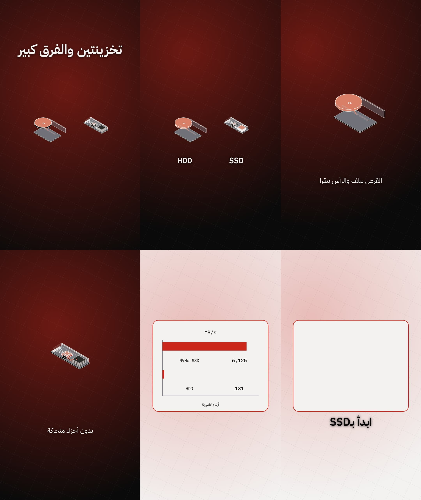

# مهارة Creative Scene Director — تقرير الدمج والتحقق

**التاريخ:** 2026-11-07 · **النطاق:** إدخال مهارة `Video Motion — Creative Scene Director` داخل الاستوديو كمهارة مستقلة، مع التحقق من القدرات الفعلية من الكود والمانيفستات والاختبارات، واختبار عملي على مشهد تقني (SSD مقابل HDD).

## القرار

المهارة اندمجت كملحق اختياري في `medo-motion/skills/scene-director/SKILL.md` — **من غير أي تعديل** على المهارة الأساسية `medo-motion/SKILL.md` أو المحركات أو الـtemplates. حراسة الانجراف الدائمة في `tests/test_scene_director.py` (14 اختبارًا) بتحط ادعاءات المهارة في مقارنة آلية مع المانيفستات والكود.

## المهارة — إيه اللي اتغير عن النسخة المرفوعة

النسخة المرفوعة كانت سليمة في معظمها؛ التعديلات كانت **تصحيحات مبنية على الكود** (شرط ٢) وإضافة مصفوفة توافر فعلية:

| الموضوع | التصحيح |
|---|---|
| توافر القدرات per engine | اتضافت مصفوفة موثّقة من الكود: data recipes في **K/R فقط** (مش P) · الأيقونات (275) في **P/K فقط** · كتالوج الانتقالات (14) في **P/K فقط** (R = hard cuts + SceneEffects) · machine geometry في الثلاثة (P `machine_kit.py` · K/R `machine-kit.js` حرفيًا متطابق) · Three.js اختياري K (`three-layer.js`) + R (`ThreeCanvas`) بدون adapter لـP |
| موديلات الآلات | القائمة الخمسة اتثبتت حرفياً من `SUPPORTED_ARCHETYPES` في المحركين؛ وبدائيات `custom` اتوضحت (`slab`، `slab_stack`، `ticks`، `poly3d`، `cylinder`، `ring`، `wire`، `coil`) — القائمة اتوحدت مع مفتاح الرسم الفعلي في `machine-kit.py`/`machine-kit.js` بعد ملاحظة المراجعة، ومحمية باختبار حراسة — مع قاعدة "التمثيل الأمين أو التغيير" |
| One-Take | "لا typing ولا drag" اتثبتت من `one_take.py` + `docs/one-take.md` (Phase 2C) |
| بيانات الوصفات | مكان كل عقد اتوضّح: `source/unit/decimals/unique-ids` في `validateDataset` · التصنيف `user/source/illustrative` في `tools/visual_direction.py` · والوصفات نفسها **K/R فقط** |
| البوصات | "فئات التمثيل" اتحوّلت لcasting حقيقي من `poses.json`: 49 وضعية (30 كامل + 19 نصف جسم) بالـslugs والـtags |
| الحركات | 2,239 تقنية / 44 فئة اتثبتت بـ`tools/techniques.py --validate`؛ وحقول الوصفات (`use_when`/`avoid_when`/`bans`/`evidence`) اتضافت |
| الخطوط | **مفيش رقم ثابت** في المهارة — المانيفست هو المرجع (الرقم في الوثائق القديمة منحرف، والتفصيل تحت) |
| ستايلات محلية | التمييز اتوضح: 163 ستايل في `styles.json` ≠ المراجع المحلية الثمانية في `medo-motion/styles/*.md` (كلهم موجودين ✓) |
| بروتوكول المشهد | جدول ربط الـ19 حقل بملفات الخطة الحقيقية (`beats.json` / `copy.json` / `text-direction.json` / `visual-direction.json` / `design.json` / `techniques.json`) |

الملحق الأخير في المهارة ("Studio reality checks") بيجمّع القرارات دي في جدول واحد، و`tests/test_scene_director.py` بيقفل كل صف فيه على الكود.

## التحقق من القدرات (شرط ٢)

كل ادعاء اتتحقق من المصدر الأول مش من الوثائق:

- **الكود:** `machine_kit.py` / `machine-kit.js` (الأركتايبات والبدائيات وحالات الحركة `spin`/`packet_flow`/…) · `data-recipes.js` · `one_take.py` · `captions.py`/`captions.js` (`draw_directed_text`/`drawDirectedText`) · `machine-visual.js` · `transition.js` · `three-layer.js` + `ThreeCanvas.tsx` · absence of icons/data-recipes in R/P بالمصفوفة.
- **المانيفستات:** `techniques.json` (2,239/44 — `--validate` = OK) · `styles.json` (163) · `poses.json` (49 = 30+19) · `backgrounds.json` (12) · `transitions.json` (14) · `text-animations.json` · `fonts.json`.
- **الاختبارات:** `tools/techniques.py --validate` · `tests/` (الشبكة الكاملة) · وdrift-guard جديد `tests/test_scene_director.py` (14/14 ✓).

### اكتشافات الانجراف (موجودة قبل هذا الشغل — لم تُلمس)

1. **الخطوط:** `assets/fonts/fonts.json` فيه **125 عيلة** (كلها OFL) بينما `docs/fonts.md` و`AGENTS.md` و`tests/test_fonts.py` لسه على **21 عيلة** (12 عربي + 9 لاتيني). الاختبار `test_manifest_and_files_agree` و`test_every_family_is_documented` بيفشلوا على main من غير أي تدخل — والمهارة الجديدة عمداً مش بتذكر عدداً ثابتًا.
2. **مكتبة الحركات:** `tests/test_techniques.py` (3 اختبارات) لسه بيختبر شكل الـ59 حركة الأصلية بينما المكتبة بقت 2,239 (دمج cinetic + Alansari + gl-transitions) — README العربي محدّث والاختبارات قديمة.
3. **عبارة "K-only Three bridge"** في `AGENTS.md` أضيق من الحقيقة: `docs/motion-three.md` المرحلة التاسعة بتفعّل `ThreeCanvas` في R أيضًا (والمهارة بتوصف K/R — الأدق).
4. **`tests/test_workflow.py::test_one_engine_p_frame_has_brand_size`** بيفشل عند تشغيله معزولًا (تضارب import بين `tools/text_direction.py` ونسخة المحرك) وبينجح داخل الشبكة الكاملة بترتيب الاستيراد — مشكلة عزل اختبارات قديمة.
5. **كتالوج النص الآمن ≠ مكتبة text-animations:** `text-animations.json` فيه 51 حركة، لكن الـ"caption-safe" catalog (اللي `drawDirectedText` بيقبله في P وK معًا) هو **31 id + specials + aliases** فقط — ids زي `sticker`/`clipreveal` مرفوضة من الـlint والرندر معًا (اتكشفت عمليًا وقت الاختبار واتصلحت).

## الاختبار العملي — مشهد SSD مقابل HDD (شرط ٣)

المشروع: `projects/ssd-vs-hdd/` (مساحة شغل مؤقتة — خارج Git حسب قاعدة "الاستوديو أداة مش أرشيف"). لوحات الملخص التالية اتضافت كدليل مراجعة فقط باستثناء صريح بطلب المستخدم.

**لوحة الملخص (6 لوحات من الرندر النهائي — 540 فريم):**

من اليمين لليسار (الزمن 0.5s / 2.5s / 3.5s / 5.5s / 7.5s / 9.3s): العرض (hook + موديلين أيزومتريين) → ميلان الكاميرا للـSSD → العنصر المعلومة + القرص الدوّار → المقارنة بالأرقام (إضاءة `subtle-flash` على سطر "3 أضعاف") → تدفق الحزم → الخروج (شبكة زمنية + النتيجة).

### قرارات المهارة اللي اتحققت

1. **المحرك: K (Canvas).** المشهد محتاج machine geometry + data recipes + انتقالات كتالوج + نص موجّه في تركيبة واحدة. حسب مصفوفة التوافر: الـdata recipes في K/R فقط، وR مش بيرث كتالوج الانتقالات → **K هو الوحيد اللي بيجيب الأربعة**. الـP اترفض بقرار مُعلل (مفيش data-recipes أصلية فيه) — مش بالعشوائية.
2. **التكوين:** 3 مشاهد — عرض (hook + موديلين أيزومتريين) → آلية (دوران القرص مقابل تدفق الحزم) → بيانات (كارت مقارنة + فيروودت). Treatments من `visual-direction.json`: cover/overlay/overlay.
3. **الأصول:** `nvme_ssd` (أركتايب مدعوم) + `custom` للـHDD — والمهارة بتقول "custom بس لو البدائيات تمثّل بصدق"، فاتعمل **audit حقيقي**: `tools/machine_explainer.py --check` → **PASS** على المواصفات الأربعة (occlusion قمة 2.1% للـHDD، 23.7% للـNVMe داخل العتبة 35%). + خلفية `iso-grid` + خطوط IBM Plex Sans Arabic/Mono (زوج technical من المانيفست) + بدون بوزات (قاعدة المهارة: "متشغلش المقدم لمجرد أنه موجود").
4. **الحركة:** `techniques.py --draw --seed 7` — 7 حركات مسحوبة من المكتبة (مش من الذاكرة). اللي اتنفذ: `oh-cold-open-mid-move`، `ty-recentre-line-build`، `tr-subtract-reveal`، `cam-punch-in-insert` + انتقالات الكتالوج `wipe` و`iris`. اللي اتشال بقرار: `ui-list-row-insert` و`pd-cursor-does-the-demo` ("ابني اللي الكونسبت يتحمله بس"). الكود نفسه عدّى `T04`: كل النص عبر الـdirected helpers.
5. **أمان البيانات:** أرقام فئات تقديرية (7000 مقابل 150 MB/s) في `plan/datasets/speed.json` بـ`evidence: illustrative` + شارة "أرقام تقديرية" ظاهرة على الشاشة + `data_recipe.py` = OK. مفيش رقم اتكتب كأنه مقياس حقيقي.

### النتائج المقاسة

| الفحص | النتيجة |
|---|---|
| `tools/machine_explainer.py --check` ×4 | **PASS** (X01/X03/X04) |
| `tools/data_recipe.py` | **OK** |
| `tools/reel_lint.py --scan-code` | **6 أخطاء فقط = V01 المتوقع** (التوقيت provisional لحد ما يوصل VO) — S01/S02/S06/T01/T04/M01/C02/C04/C06 كلها PASS |
| `brand_check.py --project` | **PASS** |
| رندر K كامل | **540 فريم × مرّتين** (Chromium 138) + contact sheet + مراجعة stills |
| `tests/test_scene_director.py` | **14/14 ✓** |

أخطاء V01 الستة ("draft" + "anchor must reference a measured word index") هي **بوابة الاستوديو المتعمّدة**: المهارة §9 بتقول "من غير VO التوقيت يفضل مبدئي" — والبوابة بتمنع بالظبط إن التقدير يتاخد كقياس. أول ما يوصل التسجيل: `vo_length.py` → `word-timings.json` → ربط الـanchors → `decidedBy` → V01 يقفل.

### جولات QA البصرية (اكتشافات حقيقية وتصحيحها)

1. **كول-أوتات الآلات بتتراكز في نص الكادر** (`drawMachineDiagram` بيحط النص في مركز الـsafe envelope) → مشهد بآلاتتين كان بيرسم النبملات فوق بعض. التصحيح: المشهد بيرسم نصه الموجّه بنفسه تحت كل آلة (والآلات اتكبّرت 0.52→0.62).
2. **`drawDirectedText` مفيش عنده auto-hide** — النص بيفضل ظاهر بعد `end` → الهووك فضل ظاهر 3 ثواني زيادة. التصحيح: `src/copy-draw.js` بيظبّط كل نص على نافذته في `copy.json` (اللي الـlint بيقرأها = نفس الحقيقة).
3. دوران الأقراص `spin` + تدفق الحزم `packet_flow` + شارة "تقديري" + الأعمدة اللي بتعدّ لفوق — كلهم اتبانوا في الـstills ✅.

### حدود معروفة (بيان صريح)

- مفيش VO → التوقيت provisional في كل حتة (`beats.json` متعلّم `provisional: true`)، والوصفات في `plan/machines-draft/` بـ`clock: "scene"` لحد ما X02 يبقى قابل للتنفيذ.
- الـrender server بتاع K بيقدّم 7 ملفات plan بس (allowlist) → مواصفات الآلات والداتا اتولّدت نسخة تشغيل في `src/specs/plan-data.js` والـsource of truth فاضل `plan/`.
- C05 تحذير: الكوبي بيغطي 72% (الحد 65%) — مقاومة مقروءية العربية على الموبايل (كل جملة مساحتها محسوبة على 0.4s/كلمة).
- الـK01 warnings على ملفات `src/lib/` هي من نسخة الـtoolkit نفسها (كلمات زي particle في تعليقاتها) — مش من كود المشاهد.

## ملاحظات توافق للمراجعة

1. **مينفعش المشهد يقرأ `plan/machines/*.json` أو datasets وقت الرندر** — الـallowlist ثابت. القالب محتاجوا إما تضمين المواصفات في كود المشهد (زي ما الـtests بتعمل) أو نسخة مولّدة في `src/` (النمط المستخدم هنا). لو ده مش مقصود، يبقى الـserve محتاج يتوسّع.
2. **`drawMachineDiagram`**: الكول-أوت دايمًا في مركز الـcontent envelope — مش ممكن positioning per machine. مشاهد الآلات المتعددة محتاجة نصها بنفسها أو تسلسل الآلات.
3. **دور `textElements[].role` لازم يساوي الدور اللي الـhelper بيرسم بيه** (الآلات = `label` دائمًا) — التحقق في lint بيقارن الدور بدور الـcopy، والرندر بيقارن بالدور الممرر؛ لو اختلفوا الرندر بيقع (اتضرب في الاختبار واتصلح).
4. **الوصفات (data recipes) بتتطلب word anchor مقيس جوه حدودها** حتى في الرسم — الانضباط نفسه بتاع "مفيش معلومة قبل الكلمة المنطوقة". من غير VO بنينا anchor مبدئي متعلّم.
5. الإخفاقات المذكورة فوق في قسم الانجراف (خطوط/حركات/عزل اختبارات) **موجودة على main قبل الدمج** ومقترحة كشغل منفصل — مالهاش علاقة بالمهارة.

## ملاحظات المراجعة ومعالجتها (الجولة الأولى على PR #41)

1. **انجراف قائمة بدائيات `custom` (ملاحظة المراجعة الأولى — اتصلحت).** المهارة قالت `coil` والتقرير قال `cylinder`؛ الحقيقة إن مفتاح الرسم في المحركات الثلاثة بيقبل اتحادهما مع `poly3d` أيضًا: `slab`، `slab_stack`، `ticks`، `poly3d`، `cylinder`، `ring`، `wire`، `coil` (أي primitive غير ده بيتخطاه الرسم بصمت). القائمة اتوحدت في المهارة والتقرير، واختبار حراسة جديد `test_custom_primitives_match_all_three_engines` بيستخرج المجموعة من `machine_kit.py` ونسختَي `machine-kit.js` ويقارنها بنصَّي المهارة والتقرير — أي انجراف مستقبلي هيكسر الاختبار.
2. **اختبارات المهارة ما كانتش في CI (ملاحظة المراجعة الثانية — اتصلحت).** `tests/test_scene_director.py` (14 اختبارًا الآن) اتضاف لخط **Fast CI** (`.github/workflows/ci.yml`) كخطوة مستقلة بعد اختبارات الكوفر — فحراسة الانجراف هتشتغل تلقائيًا مع كل تعديل مستقبلي.
3. **ملاحظات غير مانعة للدمج (تحتاج VO فقط — موثقة كحدود مبدئية).** توقيت المشاهد مبدئي لحد الـVO (بوابة X02)، وتغطية C05 عند 72% (فوق الحد 65% بتحذير) هتتراجع على الهاتف بعد التعليق الصوتي، واختبار P في CI هو smoke من 3 إطارات والرندر الكامل اللي في التقرير كان اختبارًا عمليًا منفصلًا.

## حدود النطاق — Scene Breakdown مقابل Scene Director (اتضاف بطلب المستخدم)

المهارة **عامة لكل فيديوهات الاستوديو** (تقني، مقارنات، تعليم لغات، سرد، بيانات، Presenter) — مش خاصة بفيديو SSD مقابل HDD اللي كان مجرد اختبار إثبات قدرة. ولضمان عدم التعارض مع مدخلات إنشاء الفيديو، اتضاف عقد فصل صريح للمهارة ومثبّت باختبار حراسة `test_scene_breakdown_boundary_is_pinned`:

| المسؤولية | تقرر | المالك |
|---|---|---|
| **Scene Breakdown** | **ماذا** يحدث في كل مشهد: عدد المشاهد وترتيبها ومحتواها وهدفها السردي | مدخلات الفيديو — تقسيم المستخدم |
| **Scene Director** (المهارة) | **كيف** يظهر كل مشهد ويتحرك داخل الاستوديو: المحرك والتكوين والحركة والشخصية والخلفية والنص والمؤثرات | المهارة |

القاعدة الملزمة: المهارة **بتشتغل جوه التقسيم المعطى** — لا تُعيد تقسيم المشاهد ولا تغيّر عددها أو ترتيبها من تلقاء نفسها. ولو لقيت التقسيم غير مناسب بصريًا أو سرديًا، **تقترح** التعديل بتعليل مكتوب بدل ما تغيّره بصمت — والتقسيم الأصلي يظل هو المعتمد لحد موافقة المستخدم.
